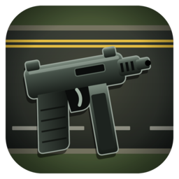

  

# Grand Theft Auto 2 Recompiled - Android

The Android port of [Grand Theft Auto 2 Recompiled](https://github.com/almost-drowned-rat/Grand-Theft-Auto-2-Recompiled),
the static recompilation of *Grand Theft Auto 2* (PC). One app: you choose your own GTA 2, the game is translated and
compiled **on your device** once, and then it plays - with a gamepad, a handheld's own controls or touch buttons.

> This project contains **no game data and no game code**. You need GTA 2 yourself: the **2004 Rockstar freeware
> release** (`GTA2.exe`, the installer, about 360 MB) or a folder with a GTA 2 installed from it. The app never
> contains any of the game's code: it is built on your device from your copy.

> **AI disclosure:** AI assistance yes (Claude Code by Anthropic).

> **Early release, tested on one device.** I have tested this port only on an AYN Odin 2 Portal (Snapdragon 8 Gen 2,
> Adreno 740). Other devices may work, but I could not test them; reports are welcome.

---

## Status

**v0.4.0** - the first Android release. Based on
[Grand Theft Auto 2 Recompiled v0.7.0](https://github.com/almost-drowned-rat/Grand-Theft-Auto-2-Recompiled/releases/tag/v0.7.0)
(Windows / Linux). Download the APK from
[Releases](https://github.com/almost-drowned-rat/Grand-Theft-Auto-2-Recompiled-Android/releases) and install it
(Android 10+, arm64). It is signed with the project's own key - every later update installs over it and keeps your
saves. The app counts its versions on its own; every release names the desktop version it is based on.

To get updates automatically, add this repository to [Obtainium](https://github.com/ImranR98/Obtainium)
(`https://github.com/almost-drowned-rat/Grand-Theft-Auto-2-Recompiled-Android`).

| Device | Chip / GPU | Driver | Result |
|---|---|---|---|
| AYN Odin 2 Portal (Android 13) | Snapdragon 8 Gen 2 / Adreno 740 | system driver | runs; first start about 4 minutes |

## Requirements

- Android 10 or newer, **arm64** (64-bit ARM)
- A GPU with a **Vulkan 1.1** driver (the system driver is enough; a Turnip driver package can be chosen too)
- Your own GTA 2: the freeware installer **`GTA2.exe`** or an **installed GTA 2 folder** (with `gta2.exe` and its
  `data` folder)
- Optional: the **translations pack** `GTA2-translations.pak` from
  [this app's releases](https://github.com/almost-drowned-rat/Grand-Theft-Auto-2-Recompiled-Android/releases) for
  German, French, Italian, Polish, Russian, Japanese and Chinese (English and Spanish come with the game)
- Free storage: about **2 GB** during the first start, about **500 MB** after it

## First start

1. Install the APK and open **GTA 2 Recomp**.
2. Pick your **GTA 2 installer** with **Browse...** - or an installed GTA 2 with **Folder...**. Optionally pick the
   translations pack and a graphics driver.
3. Tap **Install**. The app copies the game files into its own folder, translates the game's code to C and compiles
   it on your device (a few minutes, once). Keep the app open.
4. Tap **Play**.

Your installer or folder is only read: afterwards the game uses only its own copy, so you can delete or move the
original. After an app update the game is built again from that copy - no need to pick anything again.

## Playing

- **Controls:** any gamepad (also the Odin's built-in controls) or the **touch buttons**; rumble on the pad you used
  last, or the device's own vibration.
- **BACK** (the system back gesture / button) opens the side menu: **Back to the game**, **Controls** (touch
  buttons, layout, size, opacity), **Settings** (Saves: import / export, Export log, Soundtracks, Shaders, Graphics driver).
- **RECOMP OPTIONS** in the game's own options menu: render resolution, texture filtering, frame rate (30 / 60 /
  120 interpolated), aspect ratio (4:3 / 16:9 / 16:10 / 21:9, real widescreen), V-Sync, FPS counter, the old GTA 2
  Manager's gameplay settings, cheats, language, controls, MIXTAPE (your own music as a radio station: put album
  folders into `media/`), shaders (RetroArch slang shader packs: BACK > Settings > Shaders imports a .zip or a
  folder into `shader/`).
- The game's folder on the device: `Android/data/io.github.almostdrownedrat.gta2/files/` - `game/` (the game's
  files), `saves/`, `data/` (logs: `data/gta2.log`), `media/` (your music), `shader/` (your shader packs).

## Building

See the desktop repository for the port; this branch adds `packaging/android/` (the app: setup, side menu, touch
controls, Vulkan driver loader) and its kit builder `packaging/android/make_setup_assets.py`.

## Licence

The app (`packaging/android/`) is GPL-3.0-or-later (`LICENSE-GPL-3.0.txt`); the port and the toolkit are MIT
(`LICENSE`, `LICENSES.md`). The APK carries SDL 3 (zlib), libadrenotools (BSD-2-Clause), CPython (PSF), capstone
(BSD-3-Clause), pefile (MIT), unshield (MIT) and the LLVM compiler (Apache-2.0 WITH LLVM-exception); their licence
texts are in the app (About and licences).

Grand Theft Auto and GTA are trademarks of Take-Two Interactive Software. This project is not affiliated with or
endorsed by Rockstar Games or Take-Two Interactive.
